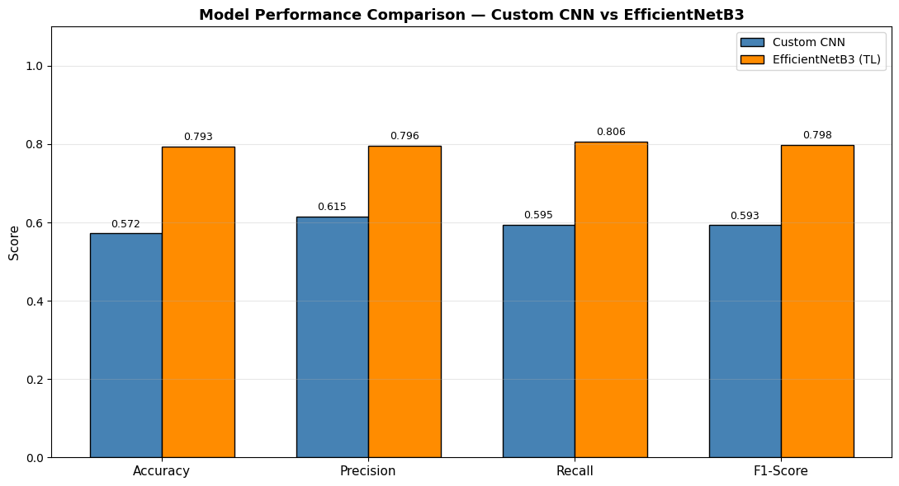
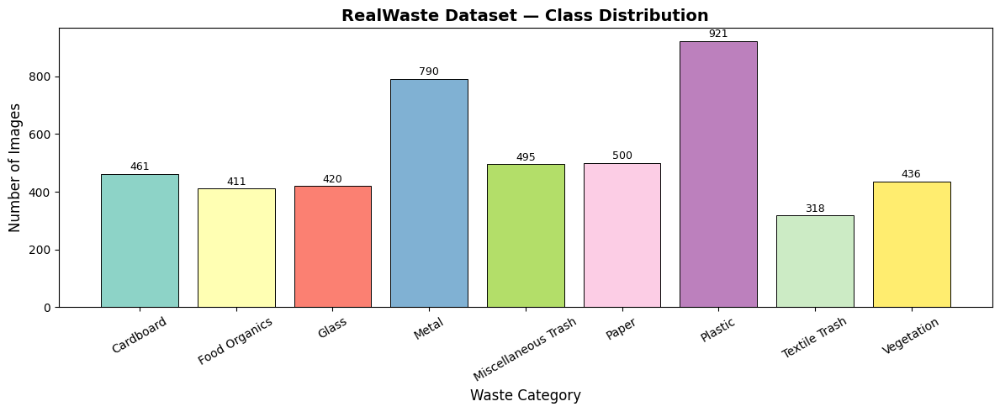
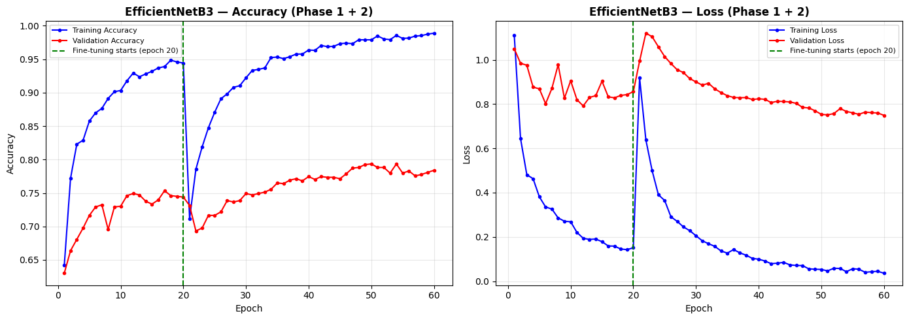
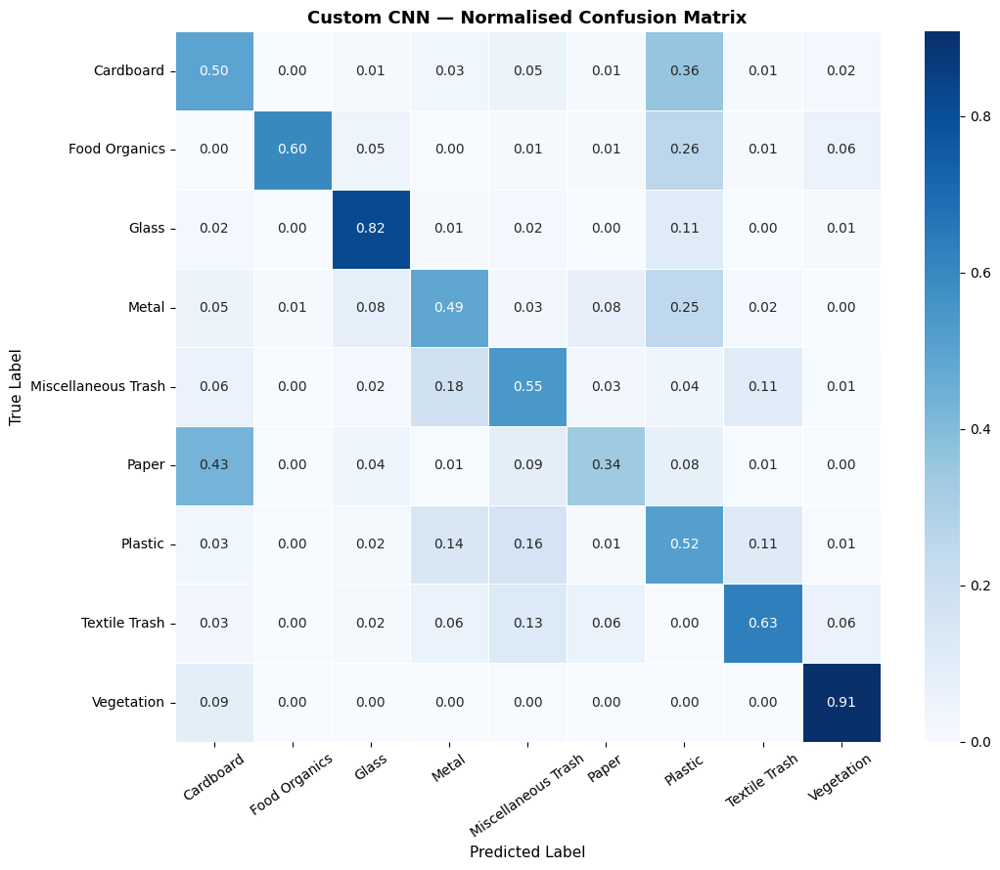
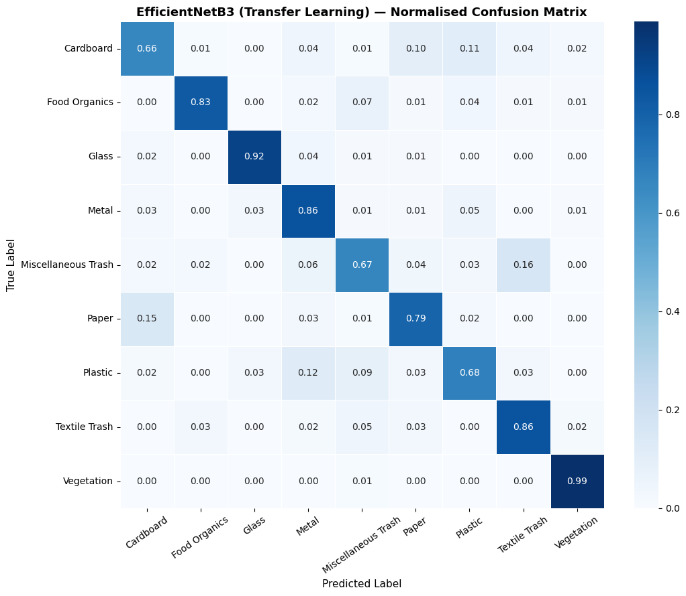

<div align="center">

# RealWaste: Custom CNN vs Transfer Learning

**Classifying 9 kinds of real-world landfill waste, and measuring exactly what ImageNet pretraining buys you**

[](https://www.tensorflow.org)
[](#models)
[](#results)
[](LICENSE)



</div>

---

## TL;DR

| | |
|---|---|
| **Task** | 9-class waste classification on **RealWaste** (UCI ML Repository, ID 908): 4,752 photos of real landfill items, imbalanced about 3:1 |
| **Models** | A custom 8-layer CNN trained from scratch (1.31M params) vs **EfficientNetB3** pretrained on ImageNet and fine-tuned in two phases |
| **Result** | Transfer learning lifts hold-out accuracy from **57.22% to 79.35% (+22.13 points)** and macro F1 from 0.593 to **0.798** |
| **Honest caveat** | The 20% hold-out set was also used for early stopping and checkpoint selection, so these numbers are optimistic (details below) |

> University coursework (ITS69204 Computer Vision and NLP, Taylor's University; module grade A), individual assignment. I'm a third-year CS student and still learning; feedback is welcome.

## The problem

Waste sorting is a real computer-vision problem: items are crushed, dirty and photographed against cluttered backgrounds, and some classes look alike (cardboard vs paper, plastic vs miscellaneous trash). The dataset is also **imbalanced**: Plastic has 921 images and Textile Trash only 318.



## Approach

**Handling imbalance.** Balanced class weights (from 0.57 for Plastic to 1.66 for Textile Trash) make errors on rare classes cost more during training.

**Model A: custom CNN, trained from scratch.** Four blocks of (Conv-BN, Conv-BN, MaxPool) with 32 → 64 → 128 → 256 filters, global average pooling instead of flattening, then Dense 512 with L2 regularisation, BatchNorm and Dropout 0.5. 1,314,345 parameters. Adam (lr 5e-4), augmentation, early stopping.

**Model B: EfficientNetB3 transfer learning, two phases.**
1. **Feature extraction.** Freeze the ImageNet backbone and train only the new head (GAP → Dense 256 → BatchNorm → Dropout 0.4 → softmax): **396,297 trainable parameters**, lr 1e-3.
2. **Fine-tuning.** Unfreeze the backbone (**10,290,135 trainable parameters**) at a 50× lower learning rate (2e-5), so the pretrained features adapt without being destroyed.



## Results

| Model | Accuracy | Macro precision | Macro recall | Macro F1 |
|---|---|---|---|---|
| Custom CNN (from scratch) | 57.22% | 0.615 | 0.595 | 0.593 |
| **EfficientNetB3 (transfer learning)** | **79.35%** | **0.796** | **0.806** | **0.798** |

Per-class F1 tells a more useful story than accuracy:

| Class | Custom CNN F1 | EfficientNetB3 F1 |
|---|---|---|
| Vegetation | 0.878 | **0.966** |
| Glass | 0.762 | 0.895 |
| Food Organics | 0.737 | 0.877 |
| Metal | 0.535 | 0.812 |
| Paper | 0.433 | 0.778 |
| Plastic | 0.484 | 0.750 |
| Textile Trash | 0.567 | 0.750 |
| Cardboard | 0.432 | 0.682 |
| Miscellaneous Trash | 0.509 | 0.674 |

- The biggest gains are on **Paper (+0.35 F1)** and **Metal (+0.28)**, classes whose texture cues the small from-scratch model could not learn from about 400–800 images each.
- **Cardboard and Miscellaneous Trash** remain the hardest. Even after transfer learning, 15% of paper images are predicted as cardboard, and 16% of miscellaneous trash is predicted as textile trash: a catch-all class overlaps visually with everything else.

<p>


</p>

## Limitations I found reviewing my own work

- **The hold-out set was used for model selection.** The notebook splits the data 80/20 and passes the 20% split as `validation_data`, so early stopping and checkpointing both looked at it. The reported accuracy is therefore an **optimistic estimate**, not a clean test score. The fix is a three-way train/validation/test split, which is how I built my later [ResScene-CNN project](https://github.com/Mazen-devs/resscene-cnn-gradcam).
- **Fine-tuning had not converged.** Phase 2 restored its best weights from the final (40th) epoch, so more epochs or a schedule might still help.
- **Single run, single split.** No seeds-averaged or cross-validated estimate yet.

## What I learned

- Pretrained features matter most when data per class is small: the gap was largest on texture-heavy classes.
- Class weights help, but they do not fix classes that are visually ambiguous by definition (Miscellaneous Trash).
- Keep a test set you never touch until the end. I learned this here and applied it in the next project.

## Next steps

- [ ] Re-run with a stratified train / validation / test split and report a clean test score
- [ ] Add Grad-CAM to see whether the model looks at the item or the background
- [ ] Try stronger augmentation and a longer fine-tuning schedule

## Run it

Open [`notebooks/realwaste_cnn_vs_efficientnetb3.ipynb`](notebooks/realwaste_cnn_vs_efficientnetb3.ipynb) in Google Colab with a GPU runtime. The notebook downloads RealWaste from the [UCI ML Repository](https://archive.ics.uci.edu/dataset/908/realwaste) itself.

```bash
pip install -r requirements.txt   # to run locally instead
```

## References

*RealWaste: A Novel Real-Life Data Set for Landfill Waste Classification Using Deep Learning* (Information, MDPI, 2023) · Tan & Le, *EfficientNet* (2019) · Yosinski et al., *How transferable are features in deep neural networks?* (2014)

---

<sub>Built by Mazen Mehna as part of a BSc Computer Science (AI) at Taylor's University. MIT licensed. RealWaste dataset © its authors, CC BY 4.0.</sub>
